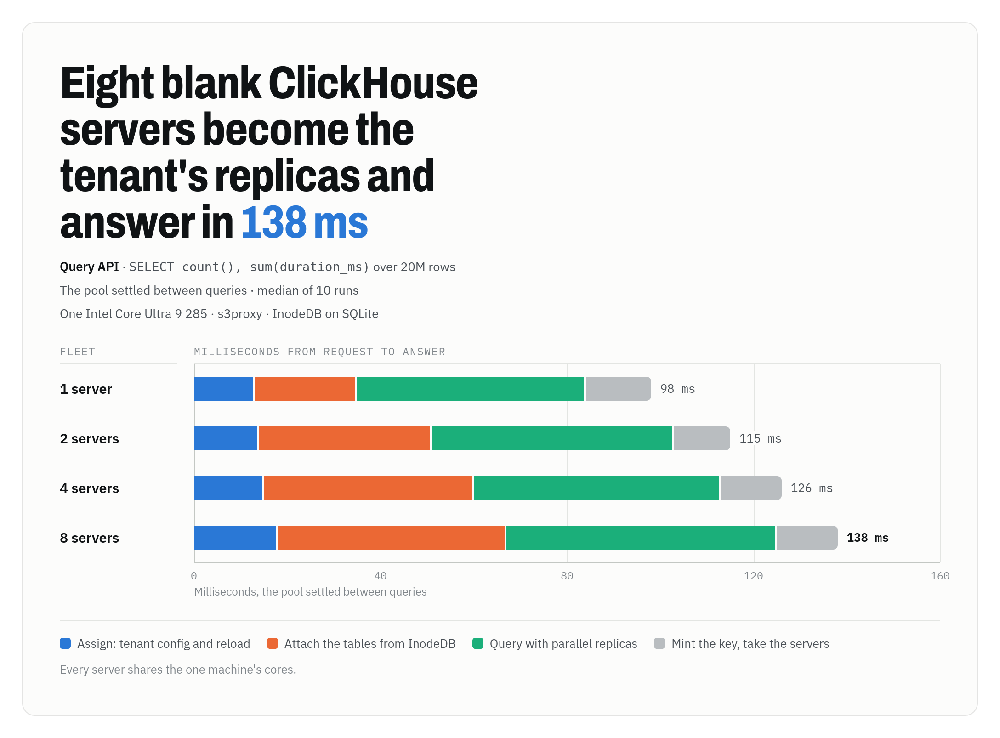
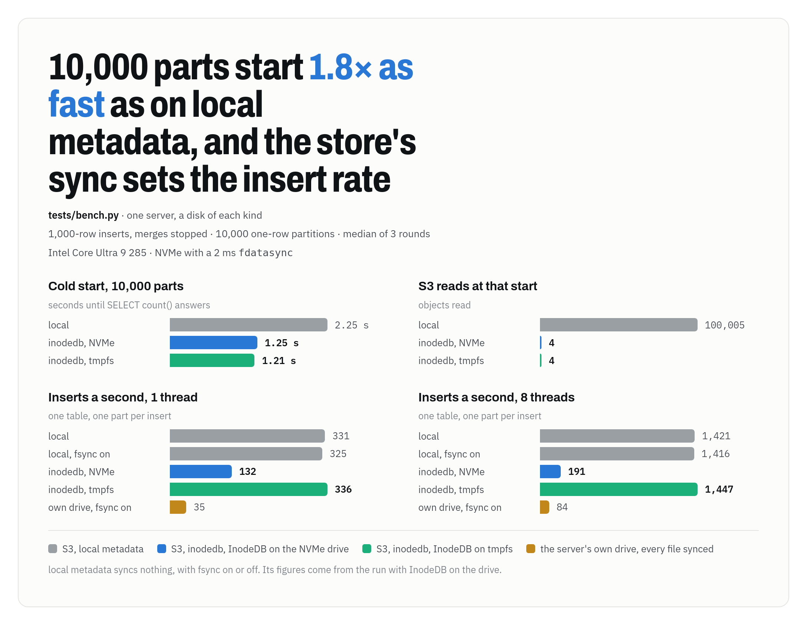

# BigHouse

BigHouse runs ClickHouse like BigQuery. Writers ingest into `MergeTree` tables on S3, one alone or several side by side, and each query runs on a fleet of ClickHouse servers that read those tables as parallel replicas, answer, and make way for fresh ones. It rests on `inodedb`, a new `metadata_type` for ClickHouse's object-storage disks that keeps the disk's file tree in [InodeDB](https://github.com/danthegoodman1/inodedb), a transactional tree of inodes, and its blobs in S3. Any number of servers read the disk while its writers change it, and a fleet needs nothing from them, so queries keep answering while they are down. The disk's code lives on the `bighouse` branch of a [fork of ClickHouse 26.10](https://github.com/danthegoodman1/ClickHouse/tree/bighouse), which this repo pins as its `ClickHouse/` submodule, and a Python service with no dependencies runs the fleets.

The disk matches an S3 disk with `local` metadata feature for feature. Of ClickHouse's 17,275 stateless tests, the five that fail only on `inodedb` read local metadata files, and pass once pointed at InodeDB's tree. Small files live in InodeDB, so 10,000 parts load in 1.29 s from 1,411 S3 reads, where `local` takes 2.30 s and 101,939 reads. A query that turns eight blank servers into the tenant's replicas and runs on them answers in 138 ms. [BENCHMARKS.md](BENCHMARKS.md) has every result and the commands to reproduce them.

<picture>
  <source media="(prefers-color-scheme: dark)" srcset="docs/images/fleet-dark.png">
  
</picture>

**Status: experimental.** The `inodedb` disk passes ClickHouse's stateless suite at parity with `local` metadata, 100 rounds of `SIGKILL` under a mixed workload, and BigHouse's feature, fence, replica and end-to-end suites. It has run in tests and benchmarks on one machine only.

## Features

**Parity with `local` metadata.** Every `MergeTree` workload that runs on an S3 disk with `local` metadata runs on `inodedb` unchanged: hardlinks, mutations, lightweight deletes and updates, `FREEZE`, partition moves and copies, TTL moves, projections and skip indexes, backups, appends and truncation, the `cache` and `encrypted` wrappers, and `ReplicatedMergeTree`. The metadata unit tests run every case against both types, and `tests/features.py` requires equal answers from both.

**Real renames and hardlinks.** A directory on the disk is an InodeDB directory, so renaming a part rewrites one entry, and a hardlink is a second entry naming the same inode. Mutations, `ATTACH PARTITION FROM` and `FREEZE` change only metadata.

**One fenced commit per transaction.** Each metadata transaction commits as one all-or-nothing InodeDB batch, and an insert commits once: its part's files, its rename to its final name and its deduplication tokens go in the same batch, so a retried insert lands once even after a crash or a fence. A starting exclusive writer takes the disk by writing its `owner` file and fences every batch on that file's version, so once it starts, every other writer commits nothing more. A retried batch carries its first request id, so it applies once.

**Shared writers.** With `inodedb_writer_mode` set to `shared`, several servers insert into and merge one disk's tables at once. Each insert's batch takes the table's next block number from a counter in InodeDB, and a merge claims its source parts before it starts and commits only while it holds them, so no two writers merge one part, and a writer with a stale view of the parts merges nothing over another's result. DDL, mutations and partition commands go through a brief exclusive writer, which fences the shared ones until they restart. `tests/shared.py` kills shared writers at random under concurrent inserts and merges, and every acknowledged insert lands once.

**Readers that share the writer's tree.** A read-only server attaches the writer's tables from InodeDB and sees new parts, merges, drops and truncation on refresh, with no copy of the metadata and no part fetches. Parallel replicas read the parts their coordinator lists, so a fleet answers from one state while the writer inserts and merges.

**Blobs outlive every reader.** A blob leaves S3 only after the commit that frees it, once no reader's InodeDB lease can reach it, so a replica's queries keep reading parts the writer merged away. A replica that stops releases its lease, and the writer's deletes go ahead 0.2 s later. A writer that dies between claiming freed blobs and deleting them leaks none: its claims expire, and the restarted writer deletes them.

**Small files inline.** Files up to 16 KiB keep their bytes in InodeDB, so a 1,000-row part uploads no blob, and a cold start reads a part's small files from InodeDB rather than S3.

**Tables found in InodeDB.** The writer keeps its database definitions on the disk, so a fleet attaches every database from InodeDB, with its views and materialized views. It leaves out each database it cannot serve as the writer would, and says why: a `Memory` table, a table on another disk, or a materialized view that refreshes on a schedule.

**Warm fleets.** Each slot on a host runs a blank server, booted ahead of demand, with no disk, cluster or credentials. A query assigns its servers with one `SYSTEM RELOAD CONFIG` each, which adds the read-only disk under the query's key and a cluster naming exactly the fleet, then attaches the tables and runs. Once it answers, the pool stops each server with SIGTERM and boots a blank one in its slot.

**Keys scoped to a tenant.** Each query reads under its own InodeDB read key, rooted at the tenant's directory, which reaches nothing outside it and writes nothing. The key expires after 15 minutes, so a key that the API never revokes, because it died first, stops working on its own, and InodeDB then deletes it.

**Checked by crash loops and ClickHouse's own tests.** `tests/crash.py` kills the writer with SIGKILL under inserts, merges, mutations and truncation, then checks every table, every acknowledged batch and every blob a record names: 100 of 100 rounds pass, each restart under 1.6 s. `tests/parity.py` runs ClickHouse's stateless tests on both metadata types and fails on any test that passes only on `local`.

## Performance

These runs used one machine: an Intel Core Ultra 9 285 (24 cores, 125 GiB) with a Micron NVMe drive whose `fdatasync` takes 2 ms, s3proxy on that drive standing in for S3, and InodeDB on SQLite.

A query through the API, `SELECT count(), sum(duration_ms) FROM demo.events` over 20 million rows, with the pool settled between queries. Median of 10 runs, in ms:

| Servers | Assign | Attach | Query | Total |
|---|--:|--:|--:|--:|
| 1 | 13 | 22 | 49 | 98 |
| 2 | 14 | 37 | 52 | 115 |
| 4 | 15 | 45 | 53 | 126 |
| 8 | 18 | 49 | 58 | 138 |

Assigning writes each server's tenant config and reloads it, which starts the disk and its InodeDB lease. Attaching reads the databases' definitions from InodeDB and loads their parts, on the first server and then on the rest at once. The rest of each total, 12 to 14 ms, mints the query's key and takes the servers from the pool. Every server shares the one machine's cores, so here a larger fleet adds coordination and no CPU; on separate hosts, each server brings its own.

The disk against `local` metadata, one of each on the same server and s3proxy, median of 3 rounds:

<picture>
  <source media="(prefers-color-scheme: dark)" srcset="docs/images/metadata-dark.png">
  
</picture>

Inserts a second into one table, 1,000 rows and one part per insert. Fsync on sets `fsync_after_insert` and `fsync_part_directory`.

| Inserts into | Each insert syncs | 1 thread | 8 threads |
|---|---|--:|--:|
| S3, `local` metadata | nothing | 325 | 1,374 |
| S3, `local` metadata, fsync on | nothing | 325 | 1,356 |
| S3, `inodedb`, InodeDB on the NVMe drive | one InodeDB commit | 131 | 189 |
| S3, `inodedb`, InodeDB on tmpfs | one InodeDB commit | 337 | 1,383 |
| The server's own drive, fsync on | 14 files and directories | 35 | 84 |

An `inodedb` insert is durable when it returns: it makes one InodeDB commit, which waits for the store's sync. `local` metadata writes its files without syncing them, and on an object-storage disk the fsync settings sync nothing, so its two rows make the same calls. A durable insert without InodeDB means MergeTree on the server's own drive with both settings on, which syncs 14 files and directories per insert. One table commits its new parts one at a time, so on a drive whose sync takes 2 ms a table takes about 190 inserts a second however many threads insert. With syncs that take microseconds, as on datacenter NVMe with power-loss protection, `inodedb` matches `local`. tmpfs stands in for such a drive here.

| | `local` | `inodedb`, InodeDB on NVMe | `inodedb`, InodeDB on tmpfs |
|---|--:|--:|--:|
| 10,000 parts written | 7.0 s | 50.4 s | 5.6 s |
| Cold start, 10,000 parts | 2.30 s | 1.29 s | 1.23 s |
| S3 reads at that start | 101,939 | 1,411 | 1,822 |

### Trade-offs

- **Insert rate on slow syncs.** On this drive one table takes 131 durable inserts a second on one thread, against `local`'s 325 unsynced ones, and 10,000 parts take 50 s against 7.0 s. Larger inserts, or `async_insert`, write fewer parts.
- **One table's inserts commit in turn.** Each part commits under the table's parts lock, which orders a table's new parts. With fast syncs, the part's batch sets the pace: on tmpfs, 8 threads insert 1,383 times a second against 337 on one.
- **Schema changes need an exclusive writer.** Shared writers insert and merge. `ALTER`, mutations, partition operations, `TRUNCATE`, and `CREATE`, `DROP` or `RENAME` go through an exclusive writer, which fences the shared ones while it holds the disk.
- **One query per fleet server.** A config reload can add a disk but cannot remove one or change its key, so each server serves one query and is then replaced. Back to back on 8 slots, fleets of 4 average 276 ms a query against 126 ms with the pool settled, because each waits for servers still booting.
- **Schema changes reach the next fleet.** Each fleet reads the schema as it attaches. A long-lived replica keeps the schema it attached with.
- **Databases a fleet leaves out.** A fleet serves tables whose data lies on the disk, so it leaves out databases with `Memory` tables, tables on other disks, or refreshable materialized views, and names them in the response.
- **Uncommitted blobs.** A writer that crashes or loses the disk leaves in S3 the blobs of parts it had not committed, a part waiting for the table's lock among them. `local` metadata leaves those of parts still being written.
- **Whole-part replication.** Zero-copy replication ships local metadata files between replicas, so `inodedb` turns it off, and `ReplicatedMergeTree` replicas on it fetch whole parts. BigHouse's own replicas read the writer's tree instead.
- **One machine so far.** Every part of the demo runs on one host. [PRODUCTION.md](PRODUCTION.md) describes how each runs on its own.

## Compared with other metadata types

| | `inodedb` | `local` | `plain_rewritable` |
|---|---|---|---|
| File tree | In InodeDB, shared by every server | Files on each server's own disk | A directory map in the bucket |
| Servers on one disk | One exclusive writer or several shared ones, and any number of readers | One; replicas share blobs only through zero-copy replication, which upstream marks experimental | One writer |
| Hardlinks | Entries naming one inode, with a link count | A reference count in each local file | Copies of the blob, unless `enable_hard_links` is on |
| Small files | Inline in InodeDB, up to 16 KiB | A blob each | A blob each |
| Freed blobs | Deleted once no reader's lease can reach them | Deleted once the transaction commits | Deleted once the transaction commits |
| Commit | One fenced, all-or-nothing batch | Local file writes | Writes to the bucket |

## Quick start

```console
git submodule update --init
scripts/clickhouse-build          # build/programs/clickhouse; the first build takes hours
scripts/inodedb-build             # inodedb/target/release/{inodedb,idb}
demo/up                           # s3proxy, InodeDB, and a writer on http://127.0.0.1:18200
demo/load                         # 20 million rows into demo.events
python3 -m bighouse.api           # the query API on http://127.0.0.1:8080, with 16 warm slots
```

`scripts/clickhouse-build` needs clang 21, CMake, Ninja, NASM and ccache, `scripts/inodedb-build` needs Rust and `protoc` (`apt-get install protobuf-compiler`), and `demo/up` needs Docker and Python 3.11 or later. Then ask a fleet of four:

```console
$ curl -s -D - 'http://127.0.0.1:8080/query?replicas=4' \
    --data-binary 'SELECT kind, count(), avg(duration_ms) FROM demo.events GROUP BY kind ORDER BY kind'
HTTP/1.0 200 OK
X-BigHouse-Replicas: 4
X-BigHouse-Timings: {"wait_ms": 0.0, "assign_ms": 16.2, "attach_ms": 43.3, "query_ms": 67.4, "total_ms": 138.3}

click	4000000	2498.9879045
purchase	4000000	2499.60470125
scroll	4000000	2499.71659525
share	4000000	2500.51235025
view	4000000	2499.98098925
```

[demo/README.md](demo/README.md) walks through each step and what happens per query.

## Configuration

An `inodedb` disk is an S3 disk with `metadata_type` `inodedb`, InodeDB's address and a key:

```xml
<storage_configuration>
    <disks>
        <bighouse>
            <type>object_storage</type>
            <object_storage_type>s3</object_storage_type>
            <metadata_type>inodedb</metadata_type>
            <endpoint>http://127.0.0.1:11111/test/bighouse/</endpoint>
            <access_key_id>clickhouse</access_key_id>
            <secret_access_key>clickhouse</secret_access_key>
            <inodedb_endpoint>127.0.0.1:7070</inodedb_endpoint>
            <inodedb_key_file>/etc/clickhouse-server/inodedb.key</inodedb_key_file>
        </bighouse>
    </disks>
</storage_configuration>
```

The disk lives under the key's root. A write key makes a writer, and a read key, or `<inodedb_read_only>1</inodedb_read_only>`, makes a replica. [PRODUCTION.md](PRODUCTION.md#shared-writers) describes shared writers and the coordination files a control plane can manage. A writer that also keeps its database definitions on the disk, with `<database_disk><disk>bighouse</disk></database_disk>`, lets a replica attach a whole database from InodeDB: `ATTACH DATABASE name UUID '...' ENGINE = Atomic SETTINGS disk = 'bighouse'` loads every table in it, and the UUID is in `metadata/<name>.sql` on the disk.

| Setting | Default | Effect |
|---|---|---|
| `inodedb_endpoint` | | InodeDB's address |
| `inodedb_key`, `inodedb_key_file` | | The InodeDB key, inline or in a file |
| `inodedb_read_only` | 0 | Make a replica, which writes nothing and deletes no blob; the S3 setting `readonly` implies it |
| `inodedb_writer_mode` | `exclusive` | `shared` lets the writer insert and merge beside other shared writers; an exclusive writer fences them all |
| `inodedb_claim_ttl_ms` | 60 s | How long a shared writer's merge claim lasts unless renewed; renewals come every third of it |
| `inodedb_deduplication_token_ttl_seconds` | 1 h | How long shared writers keep a deduplication token; an exclusive writer keeps `non_replicated_deduplication_window` tokens |
| `inodedb_inline_file_max_bytes` | 16 KiB | Keep files up to this size in InodeDB, with no blob |
| `inodedb_spill_threshold` | 32 KiB | Move a file's record larger than this to a blob of its own |
| `inodedb_lease_lag_ms` | 10 min | How long a replica's lease holds blobs it may still read |
| `inodedb_cache_bytes` | 256 MiB | What the metadata cache holds |
| `inodedb_attempt_timeout_ms`, `inodedb_retry_timeout_ms` | 10 s, 60 s | Deadlines for one InodeDB call and for its retries |

The query API takes `--port` (8080) and `--slots` (16), and reads the disk's location from `.dev/demo/config.json`, which `demo/up` writes. Slot `i` uses native port 20000+i, HTTP port 21000+i and interserver port 22000+i on `127.0.0.1`.

## Documentation

- [demo/README.md](demo/README.md): the demo, step by step, and what happens per query.
- [PRODUCTION.md](PRODUCTION.md): each part of the demo in production, InodeDB keys and their TTLs, a query's steps as a durable workflow, fleet hosts, and S3.
- [BENCHMARKS.md](BENCHMARKS.md): every benchmark result, the machine, and the commands to reproduce them.
- [PLAN.md](PLAN.md): the development plan, with the evidence for each finished item and the work that remains.

## Development

Each suite runs against the stack `scripts/dev-up` starts and the server in `build/`.

```console
scripts/dev-up                                    # s3proxy on 127.0.0.1:11111 and InodeDB on 127.0.0.1:7070
INODEDB_TEST_ENDPOINT=127.0.0.1:7070 INODEDB_TEST_KEY=$(cat .dev/inodedb/admin.key) \
    build/src/unit_tests_dbms --gtest_filter='Metadata/*:InodeDBClientTest.*'
python3 tests/features.py                         # each feature on both metadata types, with equal answers
python3 tests/crash.py 100                        # 100 rounds of SIGKILL under a mixed workload
python3 tests/claims.py                           # a writer killed between claiming and deleting blobs leaks none
python3 tests/fence.py                            # a second writer takes the disk, and the first commits nothing
python3 tests/shared.py [--kill-rounds N]         # shared writers: inserts, merges, claims, fences and kills
python3 tests/replicas.py                         # a replica sees the writer's parts and drops, and outlives its cleanup
python3 tests/discovery.py                        # fleets attach the writer's databases from InodeDB
python3 tests/parity.py                           # ClickHouse's stateless tests on both metadata types
python3 tests/bench.py [--tmpfs] [--shared]       # inserts and cold start against local metadata, or shared writers
python3 demo/e2e.py                               # the query API answers as the writer does at 1, 2, 4 and 8 servers
demo/bench                                        # the query API's timings at each fleet size
docs/images/render.sh                             # the README's charts, from docs/images/charts.html
scripts/dev-down                                  # scripts/dev-down --wipe also deletes the data in .dev/
```

`scripts/clickhouse-build unit_tests_dbms` builds the unit tests. `tests/claims.py` pauses s3proxy, so run it alone, and `tests/parity.py` needs FUSE (`fusermount3`). The README's charts come from the data in `docs/images/charts.html`; `docs/images/render.sh` renders each in both themes with headless Firefox and ImageMagick.

| Path | Contents |
|---|---|
| `ClickHouse/` | Submodule: the `bighouse` branch of `danthegoodman1/ClickHouse`, cut from ClickHouse `v26.10.2.103-stable` |
| `ClickHouse/src/Disks/DiskObjectStorage/MetadataStorages/InodeDB/` | The `inodedb` metadata type: the gRPC client, value format, cache, storage, transaction and reader lease |
| `inodedb/` | Submodule: InodeDB |
| `bighouse/` | `stack.py` (keys, disk configs, servers), `catalog.py` (the writer's databases in InodeDB), `fleet.py` (slots, the pool of blank servers, fleets), `api.py` (the query API) |
| `tests/` | The suites above |
| `demo/` | `up`, `down`, `load`, `bench`, `e2e.py` |
| `scripts/` | `clickhouse-build`, `inodedb-build`, `dev-up`, `dev-down` |

[PLAN.md](PLAN.md#clickhouse-files-changed) names every change to ClickHouse's own files and its reason.

## License

`ClickHouse/LICENSE-BIGHOUSE` reserves all rights to BigHouse's code in the ClickHouse fork and grants no license for it. The rest of ClickHouse stays under its Apache License 2.0.
